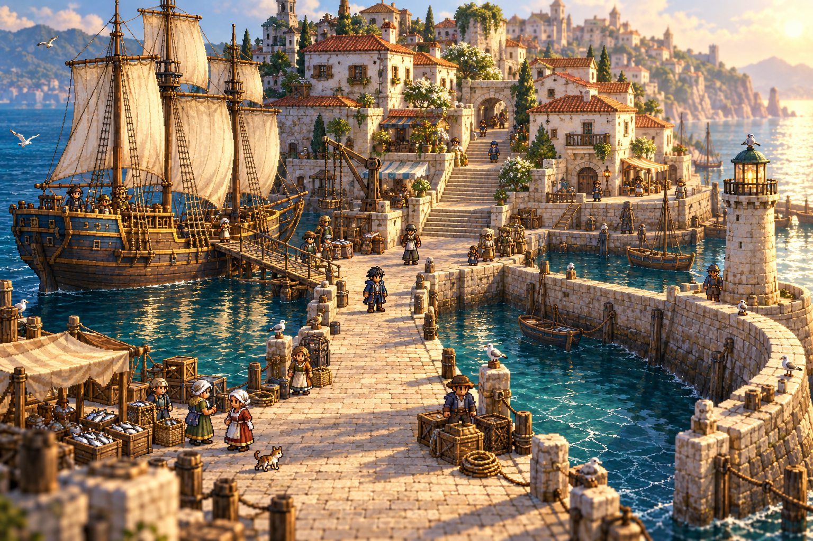

# Saltmere harbour — approved HD-2D visual reference

The user approved this generated image and explicitly asked for it to be committed for Claude's Unreal harbour look test, T-013. Preserve this reference at its original 1536×1024 resolution; [prompt.txt](prompt.txt) contains the exact prompt used. The image is a target for the look and composition, not a production texture or a collision map.

## Appearance to carry into Unreal

- Pixel-art characters against dimensional buildings, terrain and ships; fixed elevated three-quarter camera.
- White plaster and cream stone, terracotta roof tiles, ochre timber, navy clothing and deep teal water.
- Warm low-angle morning sunlight; cool shadows, water reflections and restrained atmospheric depth.
- Crisp hero and main traversal area. Depth of field belongs at distant edges; it must not obscure walkable ground, stairs or interactables.
- A three-masted merchant ship, the *Gull's Promise*, alongside the quay; a curved harbour wall and small lighthouse; stepped town streets and fish-market details.

## Movement priorities

The user specifically requested that movement be considered in the level design. Build navigable geometry in code, as required by D11; use the composition as a starting point rather than tracing every generated detail.

1. Connect the foreground arrival route to the central quay, ship gangplank and broad town stair. The stair leads to the upper street and archway exit.
2. Provide a secondary continuous route from the central quay along the curved harbour wall to the lighthouse. Widen or reshape the generated wall wherever needed for actual player clearance.
3. Keep crates, ropes, baskets and NPCs to the edges. Allow room to pass NPCs and turn at stair landings and dock junctions.
4. Use simple collision and smooth traversal surfaces on stairs and gangplanks. Decorative railings, steps and rigging must not snag the hero.
5. Keep ground, water and raised walls visually distinct. Test camera occlusion near foreground structures and the ship; use cutaways or fading if the hero disappears behind scenery.
6. Validate the complete route in motion: foreground → market → gangplank → deck, quay → upper town, and quay → lighthouse → return. Camera motion and actual collision need a playable test; the still image cannot establish either.

## First look test

Prioritize one small walkable harbour district and the morning lighting. Compare a screenshot from the intended gameplay camera with this image, then walk the routes above with the placeholder hero. Keep gameplay clarity ahead of decorative density. Record Unreal screenshots separately from this generated reference so the source and implementation remain distinguishable.

This commits the approved visual reference only. Claude retains ownership of T-013 and the Unreal build; story events and dialogue still follow D14's sign-off requirement.
